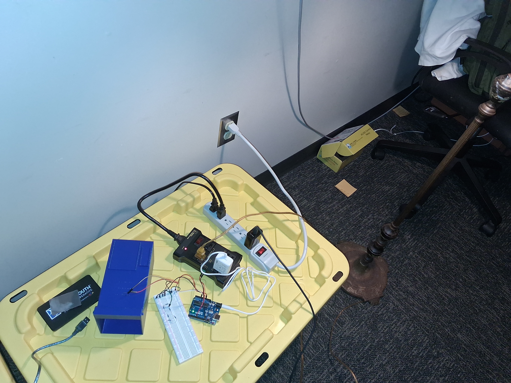
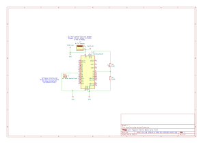
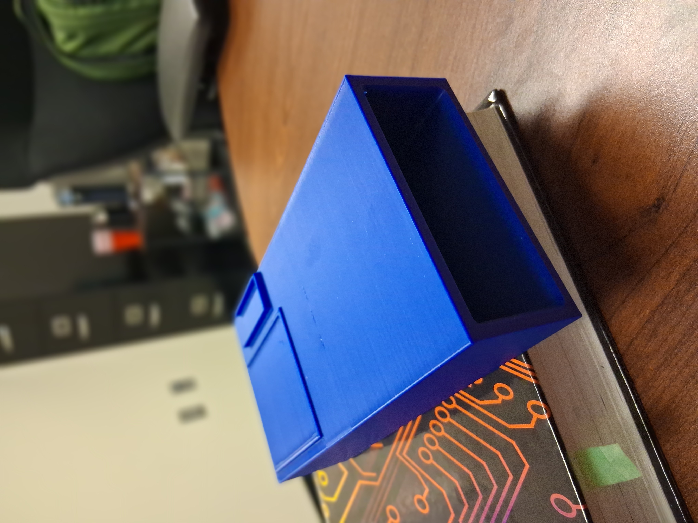
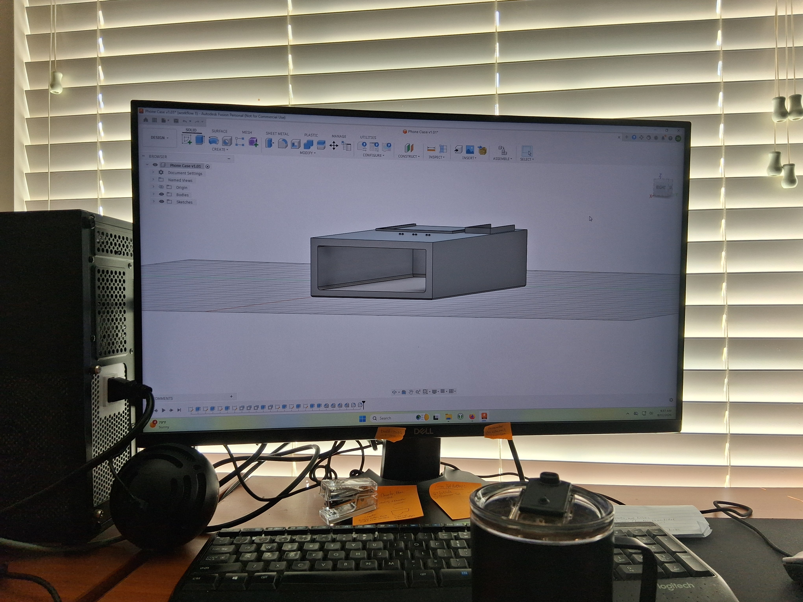
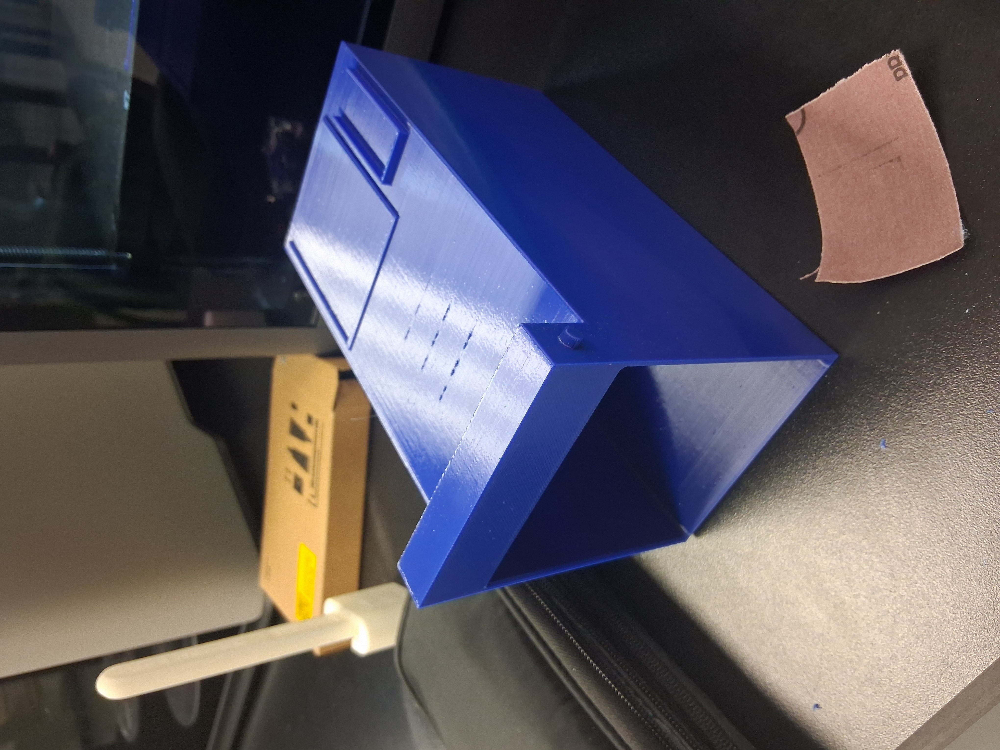

# light-triggered-arduino-lamp-alarm
Arduino lamp alarm that detects my phone's alarm screen with a photoresistor and turns on a lamp through an IoT relay.

I have to be up before sunrise (around 5 am) for AFROTC PT. Waking up has two components, sound and light. My phone alarm already handles the sound, so this project handles the light: when my phone's alarm screen lights up, a lamp turns on.

Status: working prototype. Still to do: case revision and final lamp timing.



Demo video 1: [docs/videos/Arduino_Lamp_Alarm_Demo_Video_1.mp4](docs/videos/Arduino_Lamp_Alarm_Demo_Video_1.mp4)

Demo video 2: [docs/videos/arduino_lamp_alarm_demo.mp4](docs/videos/arduino_lamp_alarm_demo.mp4)

All photos: [docs/images](docs/images)

## How it works

```
phone screen -> photoresistor -> voltage divider -> A0 Pin -> Arduino (threshold + 10 s check) -> pin 7-> IoT Power Relay -> lamp
```

The phone sits in a 3D printed case with a photoresistor (LDR) facing the screen. When the screen lights up, the LDR's resistance drops. The Arduino can't measure resistance directly, so the LDR is part of a voltage divider and the Arduino measures the voltage at pin A0 instead. When the voltage stays high enough for 10 seconds straight, the Arduino sends a signal on pin 7 to an IoT Power Relay, which turns the lamp on.

The relay plugs into a normal 120 V wall outlet. The Arduino is powered by a barrel jack adapter plugged into the relay's always-on outlet, and the lamp plugs into one of its normally-off outlets.

The lamp is meant to stay on for 30 minutes, or longer if the screen is still lit. Right now the code is set to 1 minute for testing. Taking the phone out of the case is how I "turn off" the alarm.

## Hardware

### Schematic



KiCad source: [hardware/schematic/](hardware/schematic/). PNG versions: [full schematic](docs/images/KiCAD_Photos/Arduino_Lamp_Alarm_Full_KiCAD_Schematic.png), [close-up](docs/images/KiCAD_Photos/Arduino_Lamp_Alarm_Zoomed_In_KiCAD_Schematic_Snippet.png)

The relay is drawn as a 2-pin connector (J1) since it's an off-the-shelf module, and the 120 V side (relay to lamp) isn't shown. J2 is the barrel jack adapter that powers the Arduino.

### BOM

| Part | Part number | Qty | Source | Notes |
|---|---|---|---|---|
| UNO R3 Controller Board (Elegoo, Arduino Uno compatible) | - | 1 | ELEGOO Most Complete Starter Kit | Select "Arduino Uno" in the IDE |
| Photoresistor (LDR) | - | 1 | ELEGOO Most Complete Starter Kit | Mounted in the phone case |
| 100k resistor | - | 1 | ELEGOO Most Complete Starter Kit | In series with five 10k resistors; (100k + (5 * 10k)) = 150k for R1 |
| 10k resistor | - | 5 | ELEGOO Most Complete Starter Kit | In-series with the 100k |
| Digital Loggers IoT Power Relay | - | 1 | Digital Loggers (iotrelay.com) | Control input 3.3-48 VDC |
| 9V DC barrel jack adapter | - | 1 | ELEGOO Most Complete Starter Kit | Powers the Arduino from the relay's always-on outlet |
| Breadboard | - | 1 | ELEGOO Most Complete Starter Kit | |
| Jumper wires | - | ~6 | ELEGOO Most Complete Starter Kit | Amount of wires used depends on circuit configuration and what is avaliable to you (I didn't have regular wires, only jumper wires) |
| Female to Male Jumper Wires | - | 2 | ELEGOO Most Complete Starter Kit | These plug into the photoresistor |
| USB-B cable | - | 1 | ELEGOO Most Complete Starter Kit | For uploading code to the Arduino |
| Lamp | - | 1 | - | Any lamp that can be powered by an 120V outlet (regular wall outlet) |
| External case | - | 1 | 3D printed (PETG is used, but PLA will work) | Holds the phone over the photoresistor. Slots on top for the Arduino and an optional 9V battery. Files are in `hardware/`. |

### Wiring

| From | To |
|---|---|
| Photoresistor leg 1 | 5V |
| Photoresistor leg 2 | A0 and R1 |
| R1 other leg | GND |
| Relay control + | D7 |
| Relay control - | GND |
| Barrel jack adapter | Arduino power jack (VIN) |

R1 is a 100k and five 10k resistors in series, (100k + (5 * 10k)) = 150k, since the kit doesn't have a 150k.

Nothing I wired touches 120 V, only the relay's low voltage control terminal. Unplug or switch the relay off before changing any wires.

### Circuit math

A0 reads the voltage across R1. Since the divider and the ADC both run off the same 5 V, the supply cancels out:

```
V_A0    = (5 * (R1 / (R1 + R_LDR)))

reading = (V_A0 * (1024 / 5))
        = ((1024 * R1) / (R1 + R_LDR))

R_LDR   = (R1 * ((1024 - reading) / reading))
```

These are `LDROhmsToADC()` and `ADCToLDROhms()` in the code. My hand derivation: [Arduino_Firmware_Logic_Explanation.jpg](docs/images/Arduino_Firmware_Logic_Explanation.jpg)

### Case

Designed in Fusion 360 and 3D printed. I went through about 10 versions. It's still a work in progress. Its main function is to hold the phone and photoresistor in place, while not allowing too much ambient light to get to the photoresistor.

| Early prototype | Early Prototype CAD model | Later iteration |
|---|---|---|
|  |  |  |

Files: [hardware/](hardware/) (`external_phone_case_v1.1` as .f3d, .3mf, and .stl)

In the early versions, I printed the case's walls too thick, which wasted filament. I also didn't realize that I had to insert the photoresistor into the top of the case, so that it would face the phone. This was basically impossible to do with the gap I had left for the phone, and the holes weren't even the right diameter.

In the current model, it serves its purpose well. I'm currently refactoring it to an assembly model so I can have multiple parts to fit a hinge. Watch what side you print it on, as removing the supports can be a pain.

In the future model, I want there to be a hinge for the bottom of the case. So you can keep all the good aspects of having a small sealed case, but also be able to actually insert/seat the photoresistor into where it needs to go.

## Firmware

- Arduino IDE 2.3.10 (CLI 1.5.1)
- Arduino AVR Boards 1.8.8
- No external libraries

To flash it:

1. Open `firmware/Lamp_Alarm_Arduino_IDE_Code_1.0/Lamp_Alarm_Arduino_IDE_Code_1.0.ino`
2. Tools -> Board -> Arduino Uno
3. Tools -> Port -> pick the board's COM port (mine is COM3).
4. Close the Serial Monitor if it's open, then Upload
5. Open the Serial Monitor at 9600 baud. On startup it prints three numbers that should be about 512, 452, and 301. These are calculated from the constants in the code, so if they're different, a constant was changed. If it also prints a baseline warning, the room is too bright.

## Calibration / configuration

All of these are at the top of the sketch/code.ino file.

| Constant | Value | What it does |
|---|---|---|
| `LDR_OHMS_SCREEN_ON` | `190000.0` | Screen counts as on below this resistance |
| `LDR_OHMS_SCREEN_OFF` | `360000.0` | Screen counts as off above this resistance |
| `PHONE_SCREEN_DURATION_MS` | `(10UL * 1000UL)` | How long the screen has to stay lit |
| `LAMP_DURATION_MS` | `(60UL * 1000UL)` | Minimum time the lamp stays on. 1 min for testing, will be `(30UL * 60UL * 1000UL)` |
| `RELAY_PIN` | `7` | |
| `LDR_PIN` | `A0` | |

To calibrate for a different phone or room, watch the readings in the Serial Monitor with the screen off and then on, and set the two thresholds in the gap between them. For daylight, try `LDR_OHMS_SCREEN_ON = 315000.0`. That also worked at night for me.

## Design decisions

- I used an IoT Power Relay because it's a proven, safe way to switch 120 V with a low-voltage DC signal. The 120 V wiring is sealed inside the relay and the control input is isolated, so the Arduino side never touches it.
- R1 is on the ground side so A0 reads the voltage across R1 directly. `analogRead()` measures from the pin to GND and returns a raw ADC value from 0 to 1023.
- Thresholds are in ohms instead of ADC counts since ohms actually mean something. They get converted to counts once in `setup()`.
- There are two thresholds (hysteresis) instead of one so the state doesn't flicker when the reading sits near a single value.
- The screen has to stay lit for 10 seconds so headlights or a notification midway through the night doesnn't set it off.
- Timing uses `millis()` instead of `delay()` so the loop never blocks.
- Each measurement starts with a throwaway `analogRead()`. Taking a throwaway reading first is a common practice for getting a more accurate value, especially with a high resistance like 150k.

## Results

R1 = 150k. Resistance is calculated from the reading.

| Condition | Reading | R_LDR (approx) | Lamp on? |
|---|---|---|---|
| Dark room, screen off | 3 | 51 M | No |
| Dark room, screen on | 872-875 | 26 k | Yes |
| Daylight, screen off | 251-276 | 406-462 k | No |
| Daylight, screen on | 373-381 | 253-262 k | No |

In a dark room, which is its intended use case, it triggers reliably. 
In daylight the screen-on and screen-off readings are much closer together, so it only works with the daylight threshold (`315000.0`).
The readings also are somewhat inconsistent in the daylight, this is really due to ambient room brightness, though.

## Known issues & future plans
- [ ] The lamp duration is still set to 1 minute for testing. It will be changed to 30 minutes later, so it stays on until the sun actually rises. 
- [ ] Updating the case: thicker floor, hinge, light shield around the sensor.
- [ ] Maybe add a persistent sound check along with the light check (for phones that turn the screen on for more than 10 seconds for a notification).

## Repo layout

```
firmware/Lamp_Alarm_Arduino_IDE_Code_1.0/   Arduino sketch
hardware/schematic/                         KiCad project, schematic SVG and PDF
hardware/                                   Phone case files (Fusion 360, 3MF, STL)
docs/images/                                Photos, schematic PNGs, hand derivation
docs/videos/                                Demo videos
```

## License

MIT, see [LICENSE](LICENSE).
